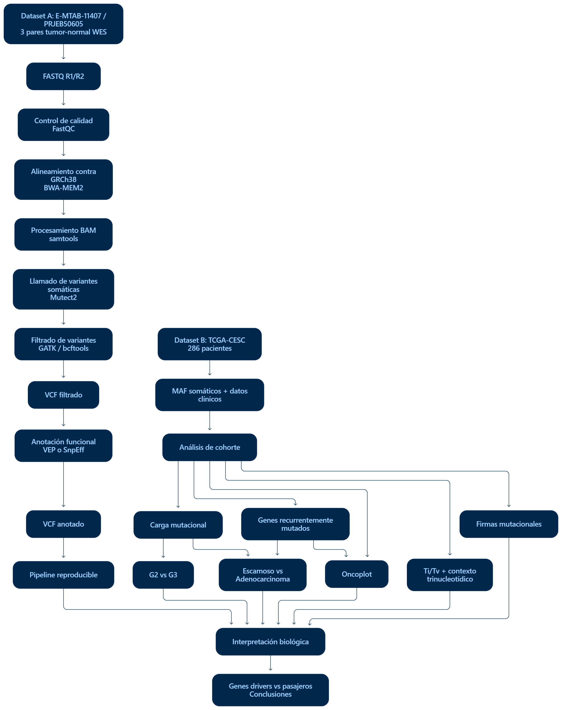

# Paisaje mutacional del cáncer cervicouterino

Proyecto individual de **Bioinformática I** orientado al análisis reproducible de variantes somáticas en cáncer cervicouterino mediante un workflow en **Nextflow DSL2** y análisis de cohorte en **R/Python**.

**Repositorio:** https://github.com/5leyla5/proyecto_cesc

## Pregunta biomédica

**¿Qué diferencias presenta el paisaje mutacional del cáncer cervicouterino según el grado tumoral (G2 vs G3) y el subtipo histológico (carcinoma escamoso vs adenocarcinoma), en términos de carga mutacional y genes recurrentemente alterados?**

Como análisis complementario, se caracterizaron el espectro de sustituciones, el contexto trinucleotídico y las firmas mutacionales SBS para explorar procesos mutacionales asociados a la heterogeneidad tumoral.

## Estrategia general

Se utilizaron dos conjuntos de datos complementarios:

- **Dataset A — E-MTAB-11407 / PRJEB50605:** cohorte pequeña tumor-normal para demostrar el procesamiento reproducible desde FASTQ hasta VCF anotado y MAF.
- **Dataset B — TCGA-CESC:** cohorte pública para el análisis biológico y estadístico del paisaje mutacional.

Esta estrategia permite separar la **validación técnica del pipeline** de la **interpretación biológica de cohorte**.

---

## Dataset A — E-MTAB-11407 / PRJEB50605

Datos WES de carcinoma escamoso cervicouterino con muestras tumor-normal pareadas.

| Paciente | Tumor | Normal |
|---|---|---|
| 1094 | ERR8314271 | ERR8314261 |
| 755 | ERR8314276 | ERR8314265 |
| 999 | ERR8314284 | ERR8314269 |

En total se utilizaron **6 muestras y 12 FASTQ paired-end**. Para la validación local se generaron subconjuntos reproducibles de **1 millón de pares de lecturas por muestra (1M)**.

Los subconjuntos 1M se utilizan únicamente para validar el funcionamiento técnico del workflow y **no representan la profundidad completa de los WES originales ni una estimación de carga mutacional real**.

### Resultados técnicos principales

- Mapeo: **96,09%–99,87%**.
- Properly paired: **93,01%–98,00%**.
- Duplicación destacada: **1094_N = 55,23%** y **1094_T = 17,61%**.
- Variantes candidatas Mutect2: **555**.
- Variantes `PASS`: **55**.
  - 1094: 6.
  - 755: 15.
  - 999: 34.

### Conversión VCF → MAF

Los VCF anotados con SnpEff fueron convertidos a MAF para demostrar un formato adecuado para análisis de cohorte.

Archivo combinado:

`results/downstream/datasetA_3patients.maf`

El MAF contiene las **55 variantes PASS** y fue validado con `maftools::read.maf()`, que reconoció correctamente las tres muestras tumorales.

---

## Dataset B — TCGA-CESC

Cohorte pública obtenida desde **NCI Genomic Data Commons (GDC)**.

- **286 pacientes únicos**.
- 287 archivos MAF descargados.
- Se conservó un MAF por paciente; para `TCGA-UC-A7PG` se retuvo el tumor primario 01A y se excluyó la muestra metastásica 06A.

### Composición clínica

| Variable | Grupo | n |
|---|---|---:|
| Grado | G2 | 126 |
| Grado | G3 | 111 |
| Histología | Squamous | 236 |
| Histología | Adenocarcinoma | 46 |
| Histología | Other | 4 |

Las comparaciones principales se realizaron entre **G2 vs G3** y **Squamous vs Adenocarcinoma**.

---

## Workflow Nextflow



El pipeline está implementado en **Nextflow DSL2**:

`FASTQ → FastQC → BWA-MEM2 → SAMtools → MarkDuplicates → Mutect2 → FilterMutectCalls → SnpEff`

### Archivos principales

- `main.nf`
- `nextflow.config`
- `conf/params.yaml`
- `samplesheet/cervical_wes_pipeline_samplesheet.csv`

### Ambientes reproducibles

- `conf/environment_nextflow.yml`
- `conf/environment_gatk4.yml`
- `conf/environment_snpeff.yml`

Para los análisis estadísticos se utilizó además un ambiente `r_cesc` con R, `readr`, `dplyr`, `tidyr`, `ggplot2` y `tibble`. Para el ajuste de firmas se creó un ambiente independiente `sigminer_cesc` con `sigminer` y `nnls`.

### Software principal

| Herramienta | Versión |
|---|---:|
| Nextflow | 26.04.6 |
| FastQC | 0.12.1 |
| BWA-MEM2 | 2.3 |
| SAMtools | 1.24 |
| seqtk | 1.5 |
| GATK | 4.6.2.0 |
| Picard | 3.4.0 |
| SnpEff | 5.4.0c |
| sigminer | 2.3.3 |

La anotación funcional con SnpEff utiliza la base:

`GRCh38.mane.1.5.ensembl`

## Genoma de referencia

Se utiliza **GRCh38**.

Archivos requeridos:

- `Homo_sapiens_assembly38.fasta`
- `Homo_sapiens_assembly38.fasta.fai`
- `Homo_sapiens_assembly38.dict`
- índices de BWA-MEM2

Los FASTQ completos, BAM, referencia genómica y MAF crudos de TCGA no se almacenan en GitHub debido a su tamaño. El repositorio conserva manifests, metadata, samplesheets, scripts y resultados livianos necesarios para reproducir el análisis.

---

## Análisis de cohorte TCGA-CESC

### 1. Carga mutacional

La carga utilizada en este proyecto corresponde al **número de mutaciones somáticas no sinónimas por tumor** y no a TMB expresado en mutaciones/Mb.

- Total: **49.458 mutaciones no sinónimas**.
- G2: mediana = **69**.
- G3: mediana = **75**.
- Wilcoxon G2 vs G3: **p = 0,808**.
- Squamous: mediana = **74**.
- Adenocarcinoma: mediana = **63**.
- Wilcoxon por histología: **p = 0,0686**.

**Resultado:** no se observaron diferencias estadísticamente significativas en carga mutacional.

### 2. Genes recurrentemente alterados

Genes más frecuentes en la cohorte:

| Gen | Pacientes | Frecuencia |
|---|---:|---:|
| TTN | 85 | 29,72% |
| PIK3CA | 81 | 28,32% |
| KMT2C | 54 | 18,88% |
| MUC16 | 49 | 17,13% |
| KMT2D | 39 | 13,64% |

- **G2 vs G3:** no se identificaron diferencias robustas después de corrección FDR.
- **Histología:** KRAS, TP53 y ERBB2 mostraron señales nominales, pero no permanecieron significativas después de FDR.

### 3. Oncoplots

Se generaron oncoplots con los 15 genes más recurrentes:

- `results/tcga/figures/tcga_oncoplot_top15_G2_vs_G3.png`
- `results/tcga/figures/tcga_oncoplot_top15_histology.png`

### 4. Espectro de sustituciones y Ti/Tv

Se analizaron **66.646 SNV**.

- Transiciones: **44.006**.
- Transversiones: **22.640**.
- **Ti/Tv = 1,9437**.

Espectro SBS6:

| Sustitución | Frecuencia |
|---|---:|
| C>T | 60,28% |
| C>G | 20,59% |
| C>A | 9,73% |
| T>C | 5,75% |
| T>G | 2,25% |
| T>A | 1,40% |

Figura:

`results/tcga/figures/tcga_SBS6_spectrum.png`

### 5. Contexto trinucleotídico SBS96

Las 66.646 SNV fueron transformadas a **96 contextos trinucleotídicos** utilizando GRCh38.

Control de referencia:

- Contextos válidos: **66.646 / 66.646 (100%)**.
- REF MAF != FASTA: **0**.
- Contextos inválidos: **0**.
- Cromosomas ausentes: **0**.

Figura:

`results/tcga/figures/tcga_SBS96_spectrum.png`

### 6. Firmas mutacionales COSMIC

Se ajustaron firmas SBS por paciente con `sigminer` mediante NNLS, utilizando firmas descritas para **Cervix-CA / TCGA / WES**.

Calidad del ajuste:

- Cosine mediano: **0,9524**.
- Cosine ≥ 0,90: **238/286** pacientes.
- Subconjunto de alta confianza (`≥50 SNV` y `cosine ≥0,90`): **224 pacientes**.

Las firmas dominantes más frecuentes fueron **SBS2** y **SBS13**, asociadas a actividad APOBEC.

En la cohorte de alta confianza, la contribución combinada `SBS2 + SBS13` presentó una mediana de **52,04%**.

#### Grado tumoral

- G2: mediana APOBEC = **47,02%**.
- G3: mediana APOBEC = **57,63%**.
- p = **0,0358**.
- FDR = **0,358**.

Se observa una tendencia descriptiva hacia mayor actividad APOBEC en G3, pero **no permanece significativa después de corrección FDR**.

#### Histología

La firma **SBS40** presentó una contribución significativamente mayor en adenocarcinoma:

- Adenocarcinoma: mediana = **3,37%**.
- Squamous: mediana = **0%**.
- p = **0,000764**.
- FDR = **0,0153**.

La asociación se mantuvo al exigir `≥100 SNV` y `cosine ≥0,90` (Wilcoxon **p = 0,000821**).

Además, `SBS40 ≥1%` estuvo presente en **51,7%** de los adenocarcinomas y **21,6%** de los carcinomas escamosos.

Figuras:

- `results/tcga/figures/tcga_APOBEC_G2_vs_G3.png`
- `results/tcga/figures/tcga_SBS40_histology.png`
- `results/tcga/figures/tcga_SBS40_prevalence_histology.png`

### 7. Drivers y posibles eventos pasajeros

La recurrencia de un gen no implica por sí sola que sea un driver.

- **PIK3CA, EP300 y FBXW7:** genes con evidencia independiente de relevancia en cáncer y recurrencia compatible con selección tumoral.
- **KMT2C y KMT2D:** genes candidatos de interés, relacionados con regulación de cromatina.
- **TTN, MUC16, FLG, SYNE1 y DMD:** deben interpretarse con cautela; genes grandes pueden acumular mutaciones con mayor frecuencia y su recurrencia no demuestra automáticamente un papel driver.

Tabla de interpretación:

`results/tcga/driver_passenger_interpretation.csv`

---

## Comparación Dataset A vs TCGA-CESC escamoso

La comparación se realizó a nivel de **símbolo génico** y es descriptiva; no constituye validación de variantes exactas.

- Genes PASS de Dataset A también observados en TCGA-Squamous: **38/52 (73,1%)**.
- Genes HIGH/MODERATE de Dataset A también observados en TCGA-Squamous: **17/19 (89,5%)**.

---

## Organización del análisis

Los scripts de análisis se encuentran en `analysis/` y siguen el orden del proyecto:

| Scripts | Etapa |
|---|---|
| `01–02` | QC técnico Dataset A |
| `03–07` | preparación TCGA, carga mutacional y genes recurrentes |
| `08–09` | comparación Dataset A vs TCGA-Squamous |
| `10–12` | datos y visualización de oncoplots |
| `13–16` | Ti/Tv, SBS6 y SBS96 |
| `17–21` | ajuste y comparación de firmas COSMIC |
| `22` | resumen integrado de resultados |
| `23–24` | conversión VCF → MAF y validación con maftools |
| `25` | interpretación driver/pasajero |

Resultados principales:

- `results/qc/`
- `results/downstream/`
- `results/tcga/`
- `results/tcga/figures/`

Documentación histórica de las entregas parciales:

- `docs/entregas/`

Diagramas del workflow y material visual del proyecto:

- `docs/mermaid-diagram.png`
- `docs/flujo_propuesto_del_proyecto_oncológico.png`

---

## Reproducción del análisis

### 1. Clonar el repositorio

```bash
git clone https://github.com/5leyla5/proyecto_cesc.git
cd proyecto_cesc
```

### 2. Preparar los ambientes

Los ambientes principales del pipeline se definen en `conf/`.

Ejemplo:

```bash
micromamba create -n nextflow_cesc -f conf/environment_nextflow.yml
micromamba create -n gatk4_cesc -f conf/environment_gatk4.yml
micromamba create -n snpeff_cesc -f conf/environment_snpeff.yml
```

Para el análisis estadístico:

```bash
micromamba create -n r_cesc -c conda-forge \
  r-base r-readr r-dplyr r-tidyr r-ggplot2 r-tibble
```

Para firmas mutacionales:

```bash
micromamba create -n sigminer_cesc \
  -c conda-forge -c bioconda \
  r-base=4.5 r-sigminer r-nnls
```

### 3. Ejecutar el workflow

Los parámetros generales se encuentran en:

`conf/params.yaml`

Ejemplo de ejecución:

```bash
nextflow run main.nf -params-file conf/params.yaml
```

Los reportes de Nextflow incluyen `report.html`, `timeline.html`, `trace.txt` y `dag.html`.

### 4. Ejecutar el análisis posterior

Los scripts pueden ejecutarse siguiendo su numeración en `analysis/`.

Ejemplos:

```bash
python3 analysis/04_tcga_mutation_burden.py
micromamba run -n r_cesc Rscript analysis/05_tcga_mutation_burden_stats.R
python3 analysis/15_tcga_SBS96_context.py
micromamba run -n sigminer_cesc Rscript analysis/17_tcga_COSMIC_signatures.R
micromamba run -n r_cesc Rscript analysis/19_tcga_signature_stats.R
python3 analysis/23_datasetA_vcf_to_maf.py
micromamba run -n sigminer_cesc Rscript analysis/24_validate_datasetA_maf.R
```

---

## Principales conclusiones

1. No se observaron diferencias significativas en la carga mutacional entre **G2 y G3** ni entre **Squamous y Adenocarcinoma**.
2. El paisaje de genes recurrentes mostró señales nominales por grupo, pero ninguna diferencia robusta después de corrección FDR.
3. El espectro mutacional estuvo dominado por **C>T**, con **Ti/Tv = 1,9437**.
4. Las firmas **SBS2/SBS13** mostraron una contribución importante en la cohorte, compatible con actividad APOBEC.
5. G3 presentó mayor actividad APOBEC descriptiva que G2, pero la diferencia no permaneció significativa después de FDR.
6. **SBS40 fue significativamente mayor en adenocarcinoma**, asociación que se mantuvo en análisis de sensibilidad.
7. La interpretación de genes recurrentes debe distinguir drivers conocidos de posibles eventos pasajeros; frecuencia de mutación no equivale automáticamente a causalidad tumoral.

En conjunto, los resultados muestran que tumores con cargas mutacionales globales similares pueden diferir en los **procesos mutacionales** que contribuyeron a generar sus alteraciones.

---

## Limitaciones

- Dataset A utiliza subconjuntos de 1M y se emplea únicamente para validación técnica.
- La rama Mutect2 de validación no incorpora Panel of Normals, recurso poblacional germinal ni estimación de contaminación.
- La carga mutacional informada corresponde a conteos no sinónimos y **no a TMB/Mb**.
- Existe desbalance entre Squamous y Adenocarcinoma.
- Tumores hipermutados pueden afectar medias; se utilizaron medianas y pruebas no paramétricas.
- Las asociaciones por gen y firma requieren corrección por múltiples comparaciones.
- El solapamiento Dataset A–TCGA se evalúa a nivel de gen, no de variante exacta.
- Las firmas fueron estimadas a partir de perfiles SBS; no se realizó descomposición de firmas ID de indels.

---

## Procedencia de los datos

### Dataset A

- BioStudies / ArrayExpress E-MTAB-11407: https://www.ebi.ac.uk/biostudies/arrayexpress/studies/E-MTAB-11407
- ENA PRJEB50605: https://www.ebi.ac.uk/ena/browser/view/PRJEB50605
- Publicación asociada: https://pmc.ncbi.nlm.nih.gov/articles/PMC5102491/

### Dataset B

- NCI GDC TCGA-CESC: https://portal.gdc.cancer.gov/projects/TCGA-CESC
- GDC Data Portal: https://portal.gdc.cancer.gov/

---

## Autora

**Leyla Saavedra Quinteros**  
Magíster en Informática Médica — Universidad de Chile  
Bioinformática I — 2026
